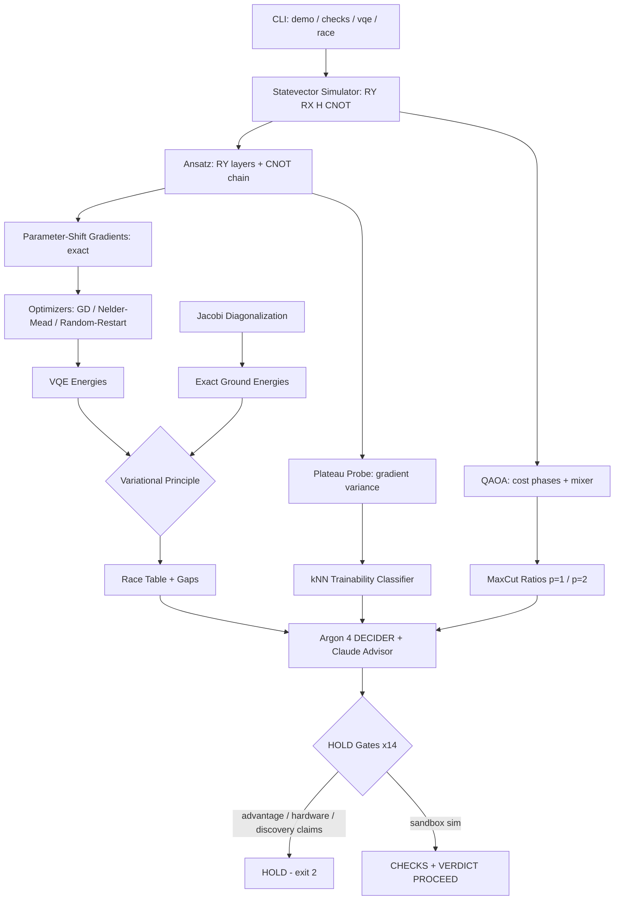
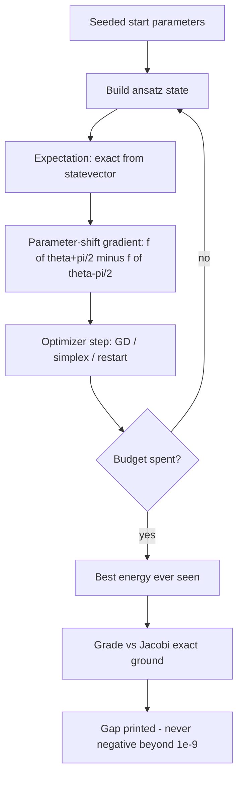
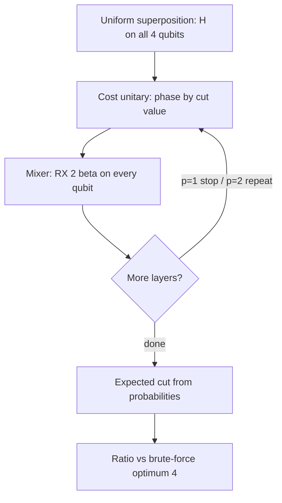
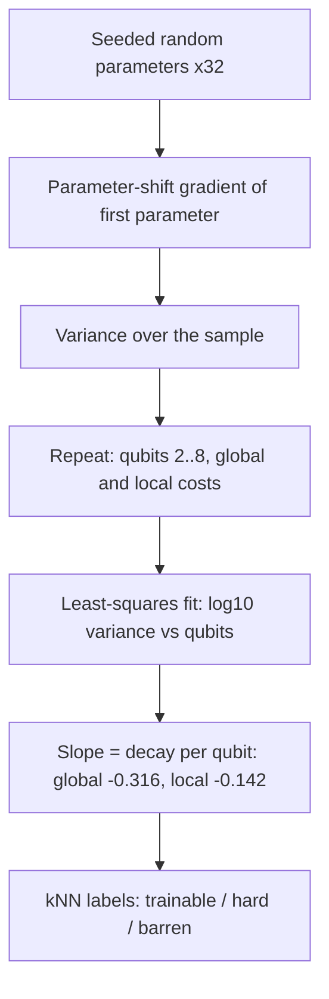
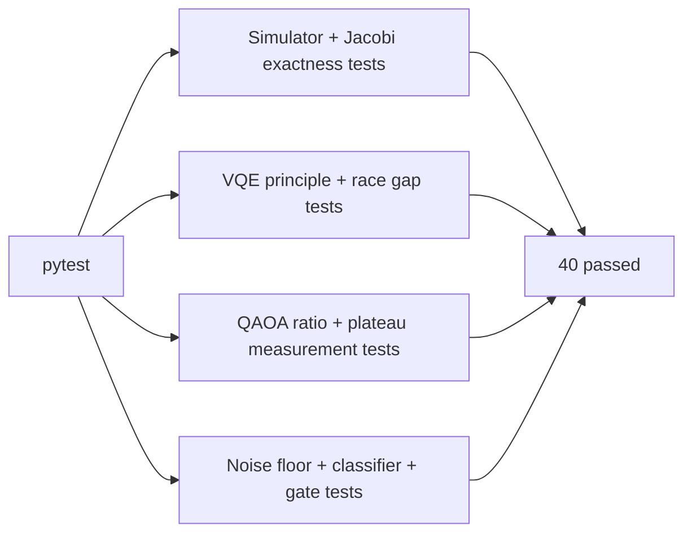
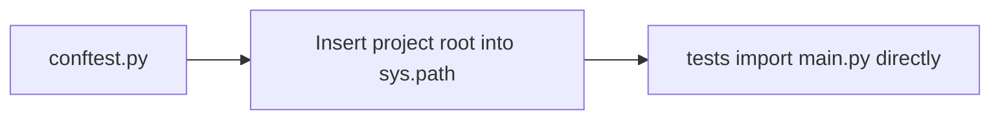
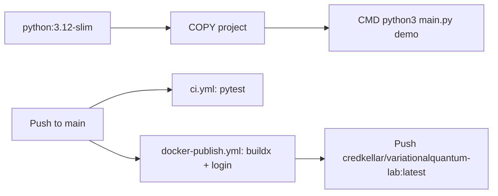

# VariationalQuantum-Lab ⚛️📉

**Variational Quantum Algorithms Lab** — by Darion Kellar

VariationalQuantum-Lab is an **educational variational quantum algorithms lab** in ONE pure-Python file. A **statevector simulator written from scratch** (≤ 8 qubits, no numpy) runs **VQE** and **QAOA** exactly; three **from-scratch optimizers** — gradient descent on exact parameter-shift gradients, Nelder-Mead, and random-restart — race on real toy problems; and every energy is graded against the **exact ground energy from full diagonalization of the same Hamiltonian**, computed in the same file by a from-scratch Jacobi eigensolver.

The honest scope is the whole point, and it is stated everywhere:

- ✅ **What it proves:** how variational algorithms actually behave at toy scale — optimizer gaps, QAOA approximation ratios, measured barren-plateau decay, and noise floors — with every number reproducible from fixed seeds.
- 🚫 **What it can never prove:** any quantum advantage. This is an exact **classical** simulation whose cost is 2^n amplitudes; that exponential bill is precisely the lesson. The systems here (≤ 8 qubits) are ones a laptop diagonalizes outright — and this lab does exactly that to grade itself.

Every quantum-advantage / real-hardware / production-optimization / drug-discovery / certified-chemistry claim sits behind a permanent HOLD gate (14 total). 🔒

[](https://github.com/kimanicollier44-cmyk/VariationalQuantum-Lab/actions/workflows/ci.yml)
[](https://github.com/kimanicollier44-cmyk/VariationalQuantum-Lab/actions/workflows/docker-publish.yml)

> ℹ️ These are the **live** workflow badges for this repo. They activate as soon as the `ci.yml` and `docker-publish.yml` files from the paste pack are pasted into `.github/workflows/` — until then they have nothing to report yet.

## 🧰 Tech Stack Badges & Full Architecture Tech Stack

### 💻 Core Programming Languages & Core Systems


- 🐍 Python 3.12, pure standard library (`math`, `hashlib`, `json`, `random`, `sys`; complex amplitudes via the built-in `complex` type) — zero dependencies, zero network, deterministic (double-run byte-identical)
- 🌊 Statevector simulator from scratch: 2^n complex amplitudes, RY / RX / Hadamard / CNOT gates, Pauli-string expectations — no numpy, so the exponential cost is visible in the code, not hidden in a library
- 📐 Exact solver from scratch: Hamiltonian matrices built from Pauli terms, diagonalized by a complex Jacobi eigensolver — TFIM-2's ground comes out at exactly −√5, as it must
- 🎯 Parameter-shift gradients: exact for RY gates (generator eigenvalues ±1/2), and asserted against central finite differences to < 1e-6 in the checks
- 🧠 TinyML kNN trainability classifier (from scratch, stdlib): trainable / hard / barren from (qubits, depth, measured gradient variance), labels generated by a threshold model fitted to the lab's own plateau measurements
- 🪑 Council seats: Gemini Argon 4 DECIDER (names-only, tighten-only) + Muse advisor (never overrides HOLD) + Google Flow plan-only (rendered = False, live = 0)

### ⛓️ Web3 & Infrastructure

- 🚫 **Not applicable — honestly.** No blockchain, no Web3, no tokens: the "infrastructure" here is one offline Python file, a Docker image, and a GitHub Actions pipeline. No fake badges here.

### ⚙️ Platform Support & Hardware Architecture


- 🖥️ Pure Python — runs anywhere Python 3.12+ runs (Linux, macOS, Windows), plus the `python:3.12-slim` Docker image
- 🔒 No quantum hardware is touched, ever: real QPU runs and paid quantum cloud queues are permanent HOLD gates (see the gate table below)

### ⚡ Low-Level Infrastructure & Performance

- 🚫 **No low-level code — honestly.** No C, no C++, no GPU, no compiled extensions: one interpreted Python file on purpose, so every amplitude, gradient, and simplex step can be read, checked, and diffed. Performance here means honest accounting — every optimizer reports its exact energy-evaluation count, and the simulator's 2^n cost is the stated subject of the lab, not a hidden embarrassment.

### 🛠️ DevOps & Build Tools


- 🐳 Docker (`python:3.12-slim`), GitHub Actions CI + Docker Publish (delivered in the paste pack)
- 🎯 Target image: `credkellar/variationalquantum-lab:latest`
- 🧪 Tests: `pytest` (40 tests) + the built-in CHECKS suite (54 checks) in `main.py`

### ☁️ Cloud Providers

- 🚫 **None — honestly.** No cloud provider is used or needed: the lab runs fully offline on your own machine or in a local Docker container. Docker Hub appears only as the registry the publish workflow pushes the image to. Quantum cloud providers appear only as a HOLD gate.

## What this does?

1. 🌊 **Statevector simulator** — a from-scratch simulator holds 2^n complex amplitudes (qubit q = bit q of the index) and applies RY, RX, Hadamard, and CNOT gates plus arbitrary Pauli strings. At 8 qubits that is 256 amplitudes — and the code makes you feel why 800 is not on the menu.
2. 🧲 **Two Hamiltonians, exactly solved** — a 4-qubit transverse-field Ising chain (−ΣZZ − ΣX, J = h = 1) and an H2-style 2-qubit toy with labelled coefficients. A from-scratch complex Jacobi eigensolver diagonalizes both: **TFIM-4 ground −4.758770, H2-style ground −1.851296** — the grades every variational result is marked against.
3. 🎛️ **Hardware-efficient ansatz** — layers of RY rotations on every qubit interleaved with a CNOT chain, plus a final RY layer: 12 parameters for the TFIM-4 depth-2 runs, 6 for the H2 depth-2 run. Expressive enough to matter, small enough to audit.
4. 🎯 **Exact parameter-shift gradients** — for an RY gate, df/dθ = [f(θ + π/2) − f(θ − π/2)] / 2 with **no** finite-difference error. The lab still checks them against central finite differences (agreement < 1e-6) because trust is not a verification method.
5. 🏁 **VQE, graded** — gradient descent drives the H2-style toy to its exact ground (gap below 1e-9, machine precision) and the TFIM-4 chain to a **1.38e-03 gap**. The variational principle is asserted in the checks: no reported energy ever beats the exact ground.
6. 🏎️ **The optimizer race** — same seeded start, same ansatz, three from-scratch optimizers: **gradient descent** (3,751 evals → gap 1.38e-03), **random-restart** (6 seeded Nelder-Mead runs, 1,801 evals → gap 4.97e-03), **Nelder-Mead** (900 evals → gap 1.16e-01). Quality per evaluation is the story, and it is printed as a table.
7. ✂️ **QAOA for MaxCut** — a 4-node square-plus-diagonal graph whose triangle caps the brute-force optimum at **4 of 5 edges**. QAOA reaches **ratio 0.8093 at p=1** and **0.9355 at p=2**, the deeper run warm-started from the p=1 optimum so the improvement is earned — and the checks assert p=2 ≥ p=1.
8. 📉 **Barren plateaus, measured** — 32 seeded random parameter draws per point, exact parameter-shift gradients: the **global** cost ⟨Z…Z⟩ variance falls **2.647e-01 → 3.190e-03** from 2 to 8 qubits (**83×**, fitted slope **−0.316 log10/qubit**, a ×0.484 factor per added qubit). The **local** TFIM cost falls far more gently (slope −0.142, ×0.721) — cost locality, as a measured fact.
9. 🔊 **Noise honesty** — a **labelled toy** depolarizing model (one global shrink factor (1−p) per entangling layer) puts a hard floor under reportable energies: at p = 0.02/layer the floor sits **0.0543 above** the exact H2-style ground, and the checks prove the clean optimum, re-read under noise, sits on that floor — no optimizer can report below it.
10. 🏷️ **Trainability classifier + seats + checks** — a from-scratch kNN labels (qubits, depth, measured variance) points trainable / hard / barren — the measured table lands 2–4 qubits trainable, 5–6 hard, 7–8 barren — watched over by the Argon 4 DECIDER (sha256 trace), Muse advisor, Google Flow plan-only, and a built-in CHECKS suite (54 checks).

## 🗺️ How it works — diagram per script

### `main.py` — the whole lab



### `main.py` § VQE loop — descend, but never below exact



### `main.py` § QAOA — phases separate, mixer stirs



### `main.py` § barren plateau probe — measure, then fit



### `tests/test_main.py` — verification



### `conftest.py` — test path setup



### `Dockerfile` + CI flow — container & publish



## Why is this cool?

1. ⚖️ The referee is **in the same file**: the exact ground energies come from a from-scratch Jacobi diagonalization, so VQE is graded by mathematics, not by a number copied from a paper.
2. 🎯 The gradients are **exact, and proven exact**: parameter-shift values are asserted against finite differences to < 1e-6 — the lab checks its own calculus.
3. 🏎️ The optimizer race is a **real race**: same start, same ansatz, three from-scratch optimizers — and the winner (gradient descent) spends the *most* evaluations doing it. Quality per eval is the honest metric, and it is printed.
4. ✂️ QAOA's improvement is **structural**: p=2 is warm-started from the p=1 optimum padded with zeros, so the deeper circuit *contains* the shallower answer — the ratio gain (0.8093 → 0.9355) is earned, then asserted.
5. 📉 The barren plateau is a **measurement, not a metaphor**: 83× of variance decay across 6 added qubits, with a fitted line — and the local-cost control group decaying 5× more gently in the same table.
6. 🔊 The noise floor is **derived, not vibes**: the depolarizing shrink formula predicts exactly where the clean optimum lands under noise (floor gap 0.0543 at p = 0.02), and the checks watch it land there.
7. 🧮 TFIM-2's exact ground comes out at **−√5**: the eigensolver is validated against a closed form before it is trusted with the 4-qubit chain.
8. 🚫 The lab's proudest gate is `quantum_advantage_claim`: a classical simulation of ≤ 8 qubits that *cannot* be quoted as an advantage — the refusal is permanent and named.
9. 🏷️ The classifier's labels come from the **lab's own measurements** — the kNN interpolates the measured plateau table instead of importing someone else's rule of thumb.
10. 🎯 Deterministic end to end: seeded starts, seeded sampling, no wall time — run it twice, get byte-identical output. A quantum lab you can diff.

## What problems this solves?

1. ❌ **Problem:** VQE demos that report an energy with nothing to grade it against. ✅ **Solution:** The exact ground is diagonalized in the same file; every VQE number ships with its gap (H2-style: below 1e-9; TFIM-4: 1.38e-03).
2. ❌ **Problem:** "The variational principle guarantees…" used as a slogan. ✅ **Solution:** It is an assertion in the checks — any energy below exact − 1e-9 fails the suite, for every optimizer in the race.
3. ❌ **Problem:** Optimizer comparisons with different starts, budgets, or ansatzes. ✅ **Solution:** One seeded start, one ansatz, evaluation counts printed — gradient descent, Nelder-Mead, and random-restart are compared on the same field.
4. ❌ **Problem:** Gradients computed by finite differences and quietly wrong. ✅ **Solution:** Exact parameter-shift gradients, with finite differences kept in the suite as the cross-examiner (< 1e-6 agreement).
5. ❌ **Problem:** QAOA ratios quoted without the brute-force optimum. ✅ **Solution:** The optimum (4 of 5, triangle-capped) is brute-forced in the open, and both p=1 (0.8093) and p=2 (0.9355) ratios are printed against it.
6. ❌ **Problem:** Barren plateaus invoked as a vibe to explain any failed training. ✅ **Solution:** Variance is sampled (32 seeded draws/point) and fitted: global cost ×0.484 per qubit vs local cost ×0.721 — the regime is identified by slope, not by mood.
7. ❌ **Problem:** Noise discussed as "results may vary". ✅ **Solution:** A labelled toy depolarizing model gives a computable floor (gap 0.0273 / 0.0543 / 0.1337 at p = 0.01 / 0.02 / 0.05 per layer) that no optimizer can beat — stated as a floor, not a fog.
8. ❌ **Problem:** Toy chemistry numbers laundered into discovery claims. ✅ **Solution:** The H2-style coefficients are labelled toys in the docstring, the README, and the code — and `drug_discovery_claim` + `certified_chemistry_result` are permanent HOLD gates.
9. ❌ **Problem:** Variational demos that need a cloud account, a queue, and a credit card. ✅ **Solution:** One offline Python file; the simulator, eigensolver, optimizers, and classifier all run locally with zero dependencies — `live_qpu_billing` is a HOLD gate.
10. ❌ **Problem:** Scaling claims extrapolated from 4 qubits to 400. ✅ **Solution:** The plateau table *is* the rebuttal, measured in-lab — and `scaled_result_extrapolation` is a permanent HOLD gate.

## How to install this?

1. 📋 Clone or download this project folder:

```bash
git clone https://github.com/kimanicollier44-cmyk/VariationalQuantum-Lab.git
```

2. 🐍 Make sure Python 3.12+ is installed: `python3 --version`
3. ▶️ Run the full demo + checks (no arguments needed):

```bash
python3 main.py
```

4. 🧪 Run the test suite:

```bash
pip install pytest
python3 -m pytest -q
```

5. 🎛️ Try the other commands:

```bash
python3 main.py checks    # 54 built-in checks
python3 main.py vqe       # VQE vs exact diagonalization, both Hamiltonians
python3 main.py race      # the 3-optimizer race on TFIM-4
python3 main.py qaoa      # QAOA MaxCut ratios, p=1 and p=2
python3 main.py plateau   # measured gradient variances + fitted decay lines
python3 main.py classify  # kNN trainability classifier report
python3 main.py brains    # Argon 4 + Muse + Flow seats
python3 main.py holds     # list all 14 HOLD gates
python3 main.py hold-demo # exits 2 - gated actions stay HOLD
```

6. 🐳 Or run it in Docker:

```bash
docker pull credkellar/variationalquantum-lab:latest
docker run --rm credkellar/variationalquantum-lab:latest
```

## Requirements

- 🐍 Python 3.12 or newer
- 📦 Dependencies: **none** (standard library only)
- 🌐 Network: **none** — fully offline
- 🧪 For tests only: `pytest`
- 🐳 Optional: Docker

## FULL project structure tree

```text
variationalquantum-lab/
├── main.py                  # the whole lab: statevector simulator, Jacobi eigensolver, ansatz, 3 optimizers, VQE, QAOA, plateau probe, noise model, classifier, seats, HOLD gates
├── conftest.py              # puts the project root on sys.path for tests
├── tests/
│   └── test_main.py         # 40 pytest tests: simulator, exact solver, gradients, VQE, race, QAOA, plateaus, noise, classifier, gates, seats
├── assets/
│   └── cover.png            # README cover image (2736 x 912)
├── .github/
│   └── workflows/
│       ├── ci.yml           # paste-in from the workflow pack
│       └── docker-publish.yml # paste-in from the workflow pack (tag: credkellar/variationalquantum-lab:latest)
├── Dockerfile               # python:3.12-slim, runs the demo
├── .gitignore               # __pycache__/, .pytest_cache/, *.pyc
└── README.md                # this file
```

> 📦 Delivered separately as paste packs (not in this tree): `.github/workflows/ci.yml` + `docker-publish.yml`, and the Docker Hub pack (100-char description, 350-char About, overview, categories).

## 🔒 HOLD gates — all 14, permanent

| # | Gate | What stays held |
|---|------|-----------------|
| 1 | `quantum_advantage_claim` | No quantum advantage claim; this is an exact classical simulation of ≤ 8 qubits |
| 2 | `real_hardware_run` | No submitting circuits to real quantum hardware from this lab |
| 3 | `production_optimization_claim` | No production optimization claims; toy problems, graded against brute force |
| 4 | `drug_discovery_claim` | No drug-discovery claims from a 2-qubit H2-style toy Hamiltonian |
| 5 | `materials_discovery_claim` | No materials-discovery claims from a 4-spin toy chain |
| 6 | `financial_optimization_claim` | No portfolio or financial optimization claims from a 4-node toy graph |
| 7 | `cryptography_claim` | No cryptographic claims: nothing here breaks, weakens, or strengthens real cryptography |
| 8 | `certified_chemistry_result` | No certified chemical-accuracy results; coefficients are labelled toys, energies are the lab's own |
| 9 | `benchmark_superiority_claim` | No claiming superiority over classical solvers at any real scale |
| 10 | `live_qpu_billing` | No spending on QPU time, cloud quantum credits, or paid hardware queues |
| 11 | `military_targeting_use` | No weapons, targeting, or military optimization use |
| 12 | `scaled_result_extrapolation` | No extrapolating ≤ 8-qubit results to large systems; the plateau section shows why not |
| 13 | `peer_reviewed_result_claim` | No presenting lab output as peer-reviewed or published science |
| 14 | `guaranteed_convergence_claim` | No guaranteeing VQE or QAOA convergence; the race table shows optimizers failing honestly |

🧑‍⚖️ **Council seats:** Gemini Argon 4 Extended Thinking — DECIDER (names-only, tighten-only, MAP → MODEL → STRESS → DECIDE, sha256 trace, `can_override_hold = False`) · Muse — advisor (`can_override_hold = False`) · Google Flow — plan-only (`rendered = False`, `live = 0`).

✅ **Verification:** pytest **40 passed** (project + clean copy) · built-in CHECKS **54/54** · double-run output **byte-identical** · `hold-demo` exits **2** · `main.py` **1,077 lines**, pure stdlib, zero network.

## 🧒 5th-grade English section

Imagine a tiny robot standing on a hilly field in the dark, trying to find the **lowest spot** in the whole field. 🌄

- The robot can only take little steps and feel whether the ground went up or down. Turning little dials changes where it steps. **VQE is that robot**: the dials are numbers in the quantum circuit, and "height" is the energy. Lower is better!
- There is a sneaky rule that helps us grade the robot: **nobody can go lower than the lowest spot** (the variational principle). This lab *knows* the lowest spot exactly — it computed it with a different, perfect method — so it can say exactly how close each robot got. One robot got within a hair's width. 🎯
- Three robots race with the same starting spot: one follows the downhill slope very carefully (gradient descent), one feels around with a stretchy triangle (Nelder-Mead), and one teleports to random spots and then feels around (random-restart). The careful one won — but it took the most steps. 🏁
- **QAOA** is a cousin game: draw lines between 4 dots and try to color the dots so as many lines as possible connect *different* colors. The best possible score is 4 out of 5 — a triangle in the drawing makes 5 impossible — and the quantum recipe scored 0.94 of the best. ✂️
- Now the sad part, called a **barren plateau**: as the field gets bigger (more qubits), the ground becomes so flat that the robot can't feel which way is downhill at all. This lab didn't just say that — it **measured** the flatness: from 2 to 8 qubits, the slope signal shrank 83 times. 📉
- And if the robot's feet are a little bit slippery (noise), there is a floor it can never step below, even with perfect walking. The lab computed that floor too. 🧊
- This is all a **pretend lab on a regular computer** — the quantum computer is being *imitated*, slowly, which is exactly why real ones are being built. Nobody discovered a medicine or won any money. It teaches how the search works, and how it breaks. 💻

---

MIT © 2026 Darion Kellar · VariationalQuantum-Lab — educational simulation only ⚛️
